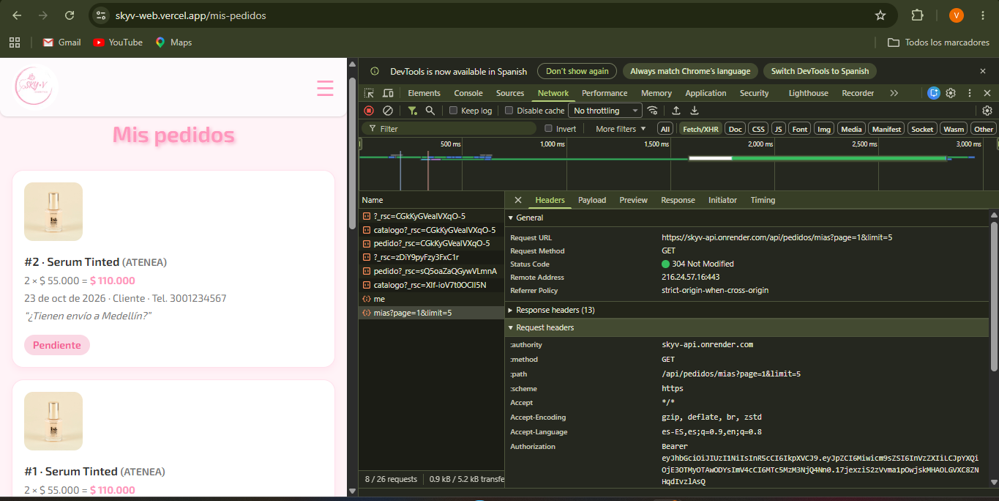

# Sky V Cosmetics · API

Esta es la API (el backend) de **Sky V Cosmetics**, la tienda virtual de mi emprendimiento de cosméticos. Guarda los productos, los usuarios y los pedidos en una base de datos PostgreSQL, y maneja el registro, el inicio de sesión y los permisos de cada usuario.

Está hecha con Node.js, Express, TypeScript, Prisma y PostgreSQL.

## Links

- **API:** https://skyv-api.onrender.com/api/productos
- **Sitio web:** https://skyv-web.vercel.app
- **Repositorio del frontend:** https://github.com/valeryy86/skyv-web

La API está en el plan gratis de Render. Si nadie la ha usado en un rato, la primera vez puede tardar cerca de un minuto en responder.

## Cómo correrlo en local

1. Instalar las dependencias:
   ```bash
   npm install
   ```
2. Crear un archivo `.env` copiando `.env.example` y llenar las variables.
3. Crear las tablas y cargar los datos iniciales:
   ```bash
   npx prisma migrate dev
   npx prisma db seed
   ```
4. Encender el servidor:
   ```bash
   npm run dev
   ```
   La API queda en http://localhost:4000

### Variables de entorno

| Variable | Para qué sirve |
|---|---|
| `DATABASE_URL` | La dirección de la base de datos PostgreSQL |
| `JWT_SECRET` | La clave secreta con la que se firman los tokens |
| `JWT_EXPIRES_IN` | Cuánto dura el token (por ejemplo `1d`, un día) |
| `PORT` | El puerto del servidor (4000) |
| `CORS_ORIGIN` | Las páginas que pueden usar la API, separadas por coma |

## Usuarios de prueba

Los crea el seed:

| Rol | Correo | Contraseña |
|---|---|---|
| admin | admin@skyv.com | Admin123* |
| user | cliente@skyv.com | Cliente123* |

*Solo para revisar esta entrega.*

## Decisiones técnicas

### ¿Cómo funciona el login, de principio a fin?

1. La persona escribe su correo y contraseña en la página y le da "Ingresar".
2. La página manda esos datos a la API con `POST /api/auth/login`.
3. La API revisa que los datos estén bien escritos y busca el usuario por su correo.
4. Con bcrypt compara la contraseña que escribió con la que está guardada. En la base de datos la contraseña no está en texto normal, sino como un hash.
5. Si coincide, la API crea un token JWT que lleva solo el `id` y el `role` del usuario. Lo firma con `JWT_SECRET` y le pone un vencimiento de 1 día.
6. La API responde con el token y los datos del usuario, sin la contraseña.
7. La página guarda el token y lo manda en cada petición en el header `Authorization: Bearer <token>`.
8. Cuando se pide una ruta protegida, por ejemplo `GET /api/pedidos/mias`, un middleware revisa que el token sea válido y no haya vencido. Si todo está bien, la API responde solo los pedidos de ese usuario.

### ¿Dónde se guarda el token y qué riesgo tiene?

El token se guarda en una cookie del navegador. La escogí porque así la sesión no se pierde al refrescar la página, y porque Next.js también puede leerla para proteger las páginas antes de mostrarlas.

El riesgo es que JavaScript puede leer esa cookie. Si alguien lograra meter código malicioso en la página (un ataque XSS), podría robarse el token y usar la cuenta hasta que venza. Para que el daño sea menor, el token dura solo 1 día.

### ¿Cuándo responde 401 y cuándo 403?

- **401:** la API no sabe quién eres. No mandaste token, o el token es falso o ya venció.
- **403:** la API sí sabe quién eres, pero no tienes permiso para hacer eso.

Ejemplo de mi proyecto: borrar un producto con `DELETE /api/productos/1`.
- Sin token, responde **401**.
- Con el token de `cliente@skyv.com`, responde **403**, porque es un usuario normal y solo el admin puede borrar productos.

### ¿Usé inteligencia artificial?

Sí, la usé como guía para aprender, igual que en la Entrega 1. Me ayudó con un paso a paso, con el código base y explicándome cosas que se me hacían más difíciles, como las capas, los middlewares y los tokens JWT.

Qué resolví y corregí yo:
- Tenía una versión vieja de Node y la instalación fallaba; tuve que actualizarla.
- Organicé mal algunas carpetas y algunos imports tenían errores, y los corregí.
- Al borrar un producto con pedidos salía "Error interno del servidor"; lo cambié para que la API muestre un mensaje claro.
- Ajusté cómo quería que se vieran las cosas y los mensajes.

## Captura de una petición protegida

